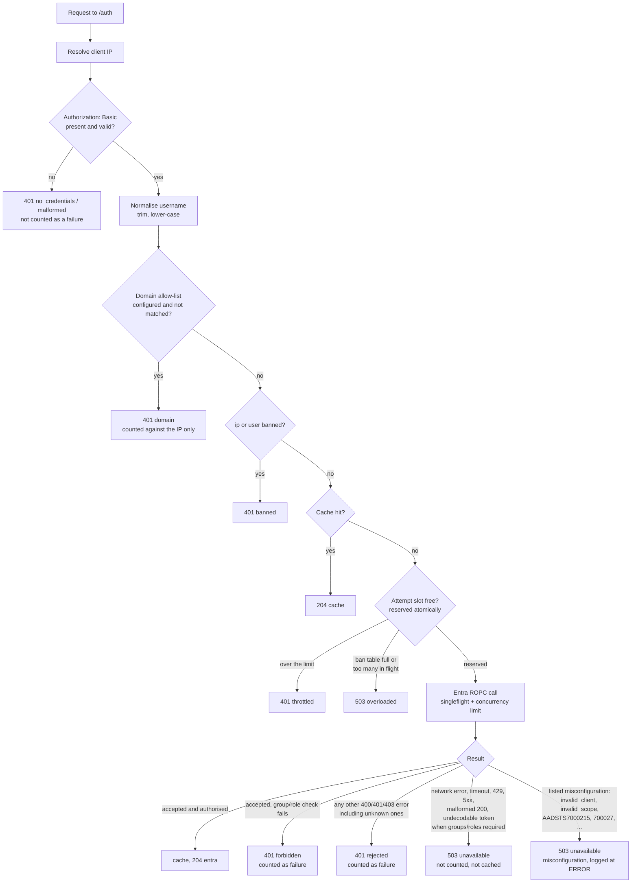

# entra-forward-auth

[](https://github.com/KazuhaHub/entra-forward-auth/actions/workflows/ci.yml)
[](https://github.com/KazuhaHub/entra-forward-auth/releases)
[](LICENSE)
[](https://pkg.go.dev/github.com/KazuhaHub/entra-forward-auth)

A small forward-auth service that lets a reverse proxy protect HTTP endpoints with a **Microsoft Entra ID
username and password sent as HTTP Basic credentials**. The proxy asks the service on every request
(nginx `auth_request`, Traefik `forwardAuth`, Caddy `forward_auth`); the service answers with a status
code only: `204` allow, `401` deny, `503` Entra unavailable.

> **Read [Security considerations](#security-considerations) before deploying.** The service uses the
> OAuth 2.0 resource owner password credentials (ROPC) flow, which bypasses multi-factor authentication
> by design.

## Contents

- [Why](#why)
- [How it works](#how-it-works)
- [Quick start](#quick-start)
- [Configuration](#configuration)
- [Reverse proxy integration](#reverse-proxy-integration)
- [Entra app registration](#entra-app-registration)
- [Security considerations](#security-considerations)
- [Troubleshooting](#troubleshooting)
- [Observability](#observability)
- [Development](#development)
- [Versioning](#versioning)
- [License](#license)

## Why

Some clients can only speak HTTP Basic: `docker login` against a private registry mirror, `pip` and
`npm` against an internal index, `curl` scripts, legacy tools. If your users live in Microsoft Entra ID
and you want them to use their existing work account there, the usual answers do not fit:

- OIDC-aware proxies and identity providers (oauth2-proxy, authentik, Authelia in front of Entra) redirect
  the user to a browser. A `docker` client cannot follow that.
- Those tools usually need a **local password** for Basic auth. Users who sign in through Entra have none,
  so you would have to create and distribute a second credential.

`entra-forward-auth` closes that gap: the client sends `user@example.com:password` as Basic credentials,
the proxy forwards the header to this service, and the service verifies it against Entra with ROPC using a
confidential client (certificate-based client assertion). Successful results are cached for a short time so
Entra is not called on every request.

It is a deliberate trade-off. If you can use a browser-based or device-code flow, use that instead.

## How it works

```
client ──Basic user:pass──▶ reverse proxy ──GET /auth (same headers)──▶ entra-forward-auth
                                   ▲                                         │
                                   └──── 204 / 401 / 503 ◀───────────────────┤
                                                                             │ cache miss only
                                                         POST /oauth2/v2.0/token (grant_type=password,
                                                         client_assertion = RS256 JWT signed with
                                                         the app's certificate key)
                                                                             ▼
                                                                    Microsoft Entra ID
```

Order of checks for `/auth` (any HTTP method; the request body is never read):



On `204` the response carries `X-Auth-User: <normalised user>` so the proxy can forward the identity
upstream. On `401` a `WWW-Authenticate: Basic realm="<realm>", charset="UTF-8"` header is added only when
`REALM` is set. Error responses carry no detail, so they cannot be used to enumerate users; the reason and
the Entra `AADSTS` code are in the log and in the metrics. Reasons: `no_credentials`, `malformed`,
`banned`, `throttled`, `domain`, `forbidden`, `rejected` (all `401`); `unavailable`, `overloaded` (`503`);
`cache`, `entra` (`204`).

Notable properties:

- Passwords, `Authorization` headers, client assertions and Entra tokens are never logged, stored or used
  as metric labels. The cache holds only `SHA-256(salt || user || 0x00 || password)` with a per-process
  random salt.
- Failures are counted per client IP and per user (IPv6 clients per /64). After `FAIL_LIMIT` failures
  within `FAIL_WINDOW` the key is banned for `BAN_TIME` without calling Entra. Attempts are reserved
  atomically before Entra is called, so parallel guessing cannot exceed `FAIL_LIMIT`, and an attempt
  counts even if the client disconnects. Domain allow-list rejections count against the IP only.
- Errors that indicate a broken service configuration (expired certificate, wrong client, wrong scope)
  are never blamed on the user: they produce `503`, an `ERROR` log line and a metric, not bans.
- There is no access log by default, because requests carry credentials.
- Dependencies: the Go standard library and the Prometheus client.

The full design is in [docs/design.md](docs/design.md).

## Quick start

You need an Entra app registration first; see [Entra app registration](#entra-app-registration). The
examples use placeholders: replace `00000000-0000-0000-0000-000000000000` and `example.com`.

### Binary

Download the archive for your platform from the
[releases page](https://github.com/KazuhaHub/entra-forward-auth/releases), then verify and install it:

```sh
sha256sum --check --ignore-missing SHA256SUMS
gh attestation verify entra-forward-auth_0.1.0_linux_amd64.tar.gz --repo KazuhaHub/entra-forward-auth
tar -xzf entra-forward-auth_0.1.0_linux_amd64.tar.gz
sudo install -m 0755 entra-forward-auth_0.1.0_linux_amd64/entra-forward-auth /usr/local/bin/
```

Run it:

```sh
export ENTRA_TENANT_ID=00000000-0000-0000-0000-000000000000
export ENTRA_CLIENT_ID=00000000-0000-0000-0000-000000000000
export ENTRA_SCOPE=api://00000000-0000-0000-0000-000000000000/Access
export ENTRA_CLIENT_CERT=/etc/entra-forward-auth/client.pem
export ENTRA_CLIENT_KEY=/etc/entra-forward-auth/client.key
entra-forward-auth            # listens on 127.0.0.1:5002
```

Try it (the service answers with a status code only):

```sh
curl -si -u 'user@example.com:password' http://127.0.0.1:5002/auth | head -n 1   # HTTP/1.1 204 No Content
curl -s  http://127.0.0.1:5002/healthz
```

### Container

The image is `ghcr.io/kazuhahub/entra-forward-auth` (`linux/amd64`, `linux/arm64`, distroless, runs as
UID 65532). It listens on `0.0.0.0:5002` inside the container and has a built-in health check.

```sh
docker run -d --name entra-forward-auth \
  --read-only --cap-drop ALL --security-opt no-new-privileges \
  -p 127.0.0.1:5002:5002 \
  -e ENTRA_TENANT_ID=00000000-0000-0000-0000-000000000000 \
  -e ENTRA_CLIENT_ID=00000000-0000-0000-0000-000000000000 \
  -e ENTRA_SCOPE=api://00000000-0000-0000-0000-000000000000/Access \
  -e ENTRA_CLIENT_CERT=/run/secrets/client.pem \
  -e ENTRA_CLIENT_KEY=/run/secrets/client.key \
  -e TRUSTED_PROXIES=172.16.0.0/12 \
  -v /etc/entra-forward-auth/client.pem:/run/secrets/client.pem:ro \
  -v /etc/entra-forward-auth/client.key:/run/secrets/client.key:ro \
  ghcr.io/kazuhahub/entra-forward-auth:0.1.0
```

Notes:

- The key file must be readable by UID 65532 (`chown 65532 client.key && chmod 0400 client.key`), or use
  Docker/Compose secrets.
- Published ports reach the container from the bridge gateway, not from loopback. The default
  `TRUSTED_PROXIES` (loopback only) would therefore ignore `X-Real-IP`; set it to the network your proxy
  connects from, as above. Better: put the proxy and the service on the same Docker network and do not
  publish the port at all.
- Pin the image by tag or digest in production. Verify the signature:

```sh
cosign verify ghcr.io/kazuhahub/entra-forward-auth:0.1.0 \
  --certificate-oidc-issuer https://token.actions.githubusercontent.com \
  --certificate-identity-regexp '^https://github\.com/KazuhaHub/entra-forward-auth/\.github/workflows/release\.yml@refs/tags/v.+$'
```

### systemd

A hardened unit using `DynamicUser` and `LoadCredential` so the private key is never readable by other
users and the service needs no dedicated account. Keep the certificate and key in
`/etc/entra-forward-auth/` owned by root with mode `0600`.

`/etc/systemd/system/entra-forward-auth.service`:

```ini
[Unit]
Description=Entra ID forward-auth for HTTP Basic
Documentation=https://github.com/KazuhaHub/entra-forward-auth
After=network-online.target
Wants=network-online.target

[Service]
Type=simple
ExecStart=/usr/local/bin/entra-forward-auth
ExecReload=/bin/kill -HUP $MAINPID
Restart=on-failure
RestartSec=2s

# Non-secret settings (tenant, client ID, scope, ...): see the configuration table.
EnvironmentFile=/etc/entra-forward-auth/env
# Secrets are passed as credentials; %d is the credentials directory.
LoadCredential=client.pem:/etc/entra-forward-auth/client.pem
LoadCredential=client.key:/etc/entra-forward-auth/client.key
Environment=ENTRA_CLIENT_CERT=%d/client.pem
Environment=ENTRA_CLIENT_KEY=%d/client.key

# Hardening
DynamicUser=yes
NoNewPrivileges=yes
ProtectSystem=strict
ProtectHome=yes
PrivateTmp=yes
PrivateDevices=yes
PrivateUsers=yes
ProtectKernelTunables=yes
ProtectKernelModules=yes
ProtectKernelLogs=yes
ProtectControlGroups=yes
ProtectClock=yes
ProtectHostname=yes
ProtectProc=invisible
ProcSubset=pid
RestrictNamespaces=yes
RestrictRealtime=yes
RestrictSUIDSGID=yes
RestrictAddressFamilies=AF_INET AF_INET6
LockPersonality=yes
MemoryDenyWriteExecute=yes
SystemCallArchitectures=native
SystemCallFilter=@system-service
SystemCallFilter=~@privileged @resources
CapabilityBoundingSet=
AmbientCapabilities=
UMask=0077

[Install]
WantedBy=multi-user.target
```

`/etc/entra-forward-auth/env`:

```sh
ENTRA_TENANT_ID=00000000-0000-0000-0000-000000000000
ENTRA_CLIENT_ID=00000000-0000-0000-0000-000000000000
ENTRA_SCOPE=api://00000000-0000-0000-0000-000000000000/Access
LISTEN=127.0.0.1:5002
```

```sh
sudo systemctl daemon-reload
sudo systemctl enable --now entra-forward-auth
systemd-analyze security entra-forward-auth   # review the exposure score
```

`LoadCredential` copies the files into a private credentials directory when the service starts, so after
rotating the certificate or key run `systemctl restart entra-forward-auth`. If you point
`ENTRA_CLIENT_CERT`/`ENTRA_CLIENT_KEY` at plain files instead, `systemctl reload` (SIGHUP) swaps the
credential without a restart.

## Configuration

Every setting is an environment variable with an equivalent flag; flags win over environment variables.
Durations accept bare seconds (`600`) or Go durations (`10m`).

| Env | Flag | Default | Meaning |
|---|---|---|---|
| `ENTRA_TENANT_ID` | `-tenant-id` | — (required) | Directory (tenant) ID or verified domain |
| `ENTRA_CLIENT_ID` | `-client-id` | — (required) | Application (client) ID |
| `ENTRA_SCOPE` | `-scope` | — (required) | Scope to request, e.g. `api://<app-id>/Access` |
| `ENTRA_CLIENT_CERT` | `-client-cert` | — | PEM certificate file (credential) |
| `ENTRA_CLIENT_KEY` | `-client-key` | — | PEM RSA private key file |
| `ENTRA_CLIENT_SECRET_FILE` | `-client-secret-file` | — | Alternative to cert/key: file holding a client secret |
| `ENTRA_AUTHORITY` | `-authority` | `https://login.microsoftonline.com` | Authority host (sovereign clouds, tests) |
| `ENTRA_TIMEOUT` | `-entra-timeout` | `8s` | Per-request timeout to Entra |
| `ENTRA_MAX_CONCURRENCY` | `-entra-max-concurrency` | `16` | Concurrent Entra calls |
| `ENTRA_ALLOWED_DOMAINS` | `-allowed-domains` | — | Comma-separated username suffixes, e.g. `@example.com` (a missing leading `@` is added) |
| `ENTRA_REQUIRED_GROUPS` | `-required-groups` | — | Comma-separated group object IDs; any one must be in `groups` claim (compared case-insensitively) |
| `ENTRA_REQUIRED_ROLES` | `-required-roles` | — | Comma-separated app role values; any one must be in `roles` claim (compared exactly). With both groups and roles set, the user needs one of each |
| `LISTEN` | `-listen` | `127.0.0.1:5002` | Listen address |
| `METRICS_LISTEN` | `-metrics-listen` | — | Separate listener for `/metrics` (default: main listener) |
| `CLIENT_IP_HEADER` | `-client-ip-header` | `X-Real-IP` | Header with the client IP; empty = peer address |
| `TRUSTED_PROXIES` | `-trusted-proxies` | `127.0.0.0/8,::1/128` | CIDRs allowed to set the client IP header |
| `REALM` | `-realm` | — | Adds `WWW-Authenticate` on 401 when set |
| `CACHE_TTL` | `-cache-ttl` | `10m` | Success cache lifetime; 0 disables |
| `CACHE_MAX_ENTRIES` | `-cache-max-entries` | `10000` | Cache bound |
| `FAIL_WINDOW` | `-fail-window` | `10m` | Failure counting window; must be > 0 when `FAIL_LIMIT` > 0 |
| `FAIL_LIMIT` | `-fail-limit` | `5` | Failures per IP / per user before a ban; 0 disables |
| `BAN_TIME` | `-ban-time` | `15m` | Ban duration; must be > `ENTRA_TIMEOUT` when `FAIL_LIMIT` > 0 |
| `RATELIMIT_MAX_KEYS` | `-ratelimit-max-keys` | `100000` | Bound on tracked IPs + users; must be >= 8 x `ENTRA_MAX_CONCURRENCY` when `FAIL_LIMIT` > 0 |
| `LOG_LEVEL` | `-log-level` | `info` | `debug`, `info`, `warn`, `error` |
| `LOG_FORMAT` | `-log-format` | `json` | `json` or `text` |
| `SHUTDOWN_DRAIN` | `-shutdown-drain` | `0s` | On shutdown, `/readyz` returns 503 for this long before the listener closes (lets load balancers notice) |
| `SHUTDOWN_TIMEOUT` | `-shutdown-timeout` | `15s` | Graceful shutdown limit |


Validation: required values present; exactly one credential (certificate and key, or a secret file); files
readable and parseable at start; durations and limits >= 0 (`FAIL_WINDOW` and `BAN_TIME` > 0 while
`FAIL_LIMIT` > 0, `BAN_TIME` > `ENTRA_TIMEOUT`, and `RATELIMIT_MAX_KEYS` >= 8 x
`ENTRA_MAX_CONCURRENCY`); the tenant must be a tenant ID or verified domain (`common`, `organizations` and
`consumers` are rejected); CIDRs valid; the authority must be `https://`
(plain `http://` only for `127.0.0.1` or `localhost`, for tests). The tenant ID and client ID are logged at
start; secrets never.

Endpoints: `/auth` (decision), `/healthz` (200 while the process runs), `/readyz` (200 when a credential is
loaded and the service is not shutting down), `/metrics` (Prometheus). Unknown paths return 404.
`SIGHUP` reloads the certificate and key; a failed reload keeps the old credential and logs an error.
On `SIGINT`/`SIGTERM`, `/readyz` turns 503, the service waits `SHUTDOWN_DRAIN`, then the server drains for up
to `SHUTDOWN_TIMEOUT`.

Subcommands: `entra-forward-auth version` and `entra-forward-auth healthcheck [-url]` (GET `/healthz`,
exit code 0 or 1; without `-url` it derives the URL from `LISTEN`; used by the container `HEALTHCHECK`).

### Client IP

`CLIENT_IP_HEADER` (default `X-Real-IP`) is honoured only when the TCP peer is inside `TRUSTED_PROXIES`
(default loopback). For `X-Forwarded-For` the list is walked right to left and the first address not in
`TRUSTED_PROXIES` is used. Any other header (`CF-Connecting-IP`, `X-Real-IP`) is a single address. If the
peer is not trusted, or the header is missing or invalid, the peer address is used and a warning is logged
at most once per minute per peer. IPv6 clients are rate-limited per /64 prefix. The client IP feeds the rate limiter, so getting it wrong means either
one shared ban bucket for all users (the proxy's address) or spoofable limits.

## Reverse proxy integration

In all examples the service listens on `127.0.0.1:5002` and a registry or application listens on
`127.0.0.1:5000`. Set `REALM` (for example `REALM=Registry`) so clients that wait for a challenge, such as
`docker login`, know to send Basic credentials.

### nginx (`auth_request`)

Requires `ngx_http_auth_request_module` (included in most distribution packages).

```nginx
server {
    listen 443 ssl;
    server_name registry.example.com;

    # Internal subrequest to the auth service. Never reachable from outside.
    location = /_entra_auth {
        internal;
        proxy_pass http://127.0.0.1:5002/auth;
        proxy_pass_request_body off;
        proxy_set_header Content-Length "";
        proxy_set_header X-Real-IP $remote_addr;
        # The Authorization header is passed through by default.
    }

    location / {
        auth_request /_entra_auth;

        # Forward the identity to the upstream.
        auth_request_set $auth_user $upstream_http_x_auth_user;
        proxy_set_header X-Auth-User $auth_user;

        proxy_pass http://127.0.0.1:5000;
    }
}
```

About `WWW-Authenticate`: when the subrequest answers `401`, nginx passes its `WWW-Authenticate` header on
to the client. So the simplest setup is to **set `REALM` on the service** (for example `REALM=Registry`)
and add nothing in nginx. Pick one place to define the challenge: either the service (`REALM` set, nothing
in nginx) or nginx (leave `REALM` unset and add the header as below). Doing both sends the challenge
twice.

```nginx
    # Only if REALM is NOT set on the service:
    location / {
        auth_request /_entra_auth;
        error_page 401 =401 @unauthorized;
        # ... as above
    }
    location @unauthorized {
        add_header WWW-Authenticate 'Basic realm="Registry", charset="UTF-8"' always;
        return 401;
    }
```

The service must see the real client address for rate limiting: `proxy_set_header X-Real-IP $remote_addr`
does this, and the service trusts that header because nginx connects from loopback.

A `503` from the service (Entra unreachable) is passed to the client as a 500 by `auth_request`; that is
intentional, because it is not a credential failure.

### nginx behind Cloudflare

When the proxy sits behind Cloudflare, `$remote_addr` is a Cloudflare address. Two ways to get the real
client address to the service; use only one.

**A. Let nginx restore the address, keep the default `X-Real-IP`.** Accept the header only from
[Cloudflare's published ranges](https://www.cloudflare.com/ips/):

```nginx
# /etc/nginx/conf.d/cloudflare-realip.conf  (generate from https://www.cloudflare.com/ips-v4 and ips-v6)
set_real_ip_from 203.0.113.0/24;      # placeholder: repeat for every Cloudflare range
real_ip_header   CF-Connecting-IP;
```

Then keep `proxy_set_header X-Real-IP $remote_addr;` in `/_entra_auth` as above.

**B. Hand the Cloudflare header to the service.** Forward it and tell the service to read it:

```nginx
    location = /_entra_auth {
        internal;
        proxy_pass http://127.0.0.1:5002/auth;
        proxy_pass_request_body off;
        proxy_set_header Content-Length "";
        proxy_set_header CF-Connecting-IP $http_cf_connecting_ip;
    }
```

```sh
CLIENT_IP_HEADER=CF-Connecting-IP
TRUSTED_PROXIES=127.0.0.0/8,::1/128      # the peer is nginx on loopback
```

In both cases the origin must only accept traffic from Cloudflare (firewall rules or authenticated origin
pulls). Otherwise anyone who reaches the origin directly can send any `CF-Connecting-IP` and evade the rate
limiter. Note also that Cloudflare must not cache authenticated responses for such a hostname.

### Traefik (`forwardAuth`)

```yaml
# dynamic configuration
http:
  middlewares:
    entra-auth:
      forwardAuth:
        address: http://entra-forward-auth:5002/auth
        trustForwardHeader: true          # Traefik is not the edge; keep X-Forwarded-* from the upstream hop
        authResponseHeaders:
          - X-Auth-User
  routers:
    registry:
      rule: Host(`registry.example.com`)
      entryPoints: [websecure]
      middlewares: [entra-auth]
      service: registry
      tls: {}
  services:
    registry:
      loadBalancer:
        servers:
          - url: http://registry:5000
```

Traefik sends the original headers (including `Authorization`) to the service and returns the service's
`401` response, headers included, to the client, so `REALM` takes effect. Set `trustForwardHeader: false`
if Traefik terminates client connections itself. Service settings:

```sh
CLIENT_IP_HEADER=X-Forwarded-For
TRUSTED_PROXIES=172.18.0.0/16            # the Docker network Traefik connects from
REALM=Registry
```

### Caddy (`forward_auth`)

```caddyfile
registry.example.com {
    forward_auth 127.0.0.1:5002 {
        uri /auth
        copy_headers X-Auth-User
    }
    reverse_proxy 127.0.0.1:5000
}
```

Caddy adds `X-Forwarded-For` to the subrequest and returns the service's non-2xx response (including
`WWW-Authenticate`) to the client. Service settings:

```sh
CLIENT_IP_HEADER=X-Forwarded-For
TRUSTED_PROXIES=127.0.0.0/8,::1/128
REALM=Registry
```

Behind Cloudflare, configure Caddy's `trusted_proxies` for the Cloudflare ranges so that it computes the
client address from `CF-Connecting-IP`/`X-Forwarded-For` correctly.

### Example: Docker registry mirror with login

A pull-through cache (`registry:2` with `proxy.remoteurl` set) protected by Entra credentials. Users run
`docker login registry.example.com` with their Entra user name and password, then
`docker pull registry.example.com/library/alpine`.

```nginx
upstream registry_backend { server 127.0.0.1:5000; }

server {
    listen 443 ssl;
    server_name registry.example.com;

    client_max_body_size 0;               # layers can be large
    chunked_transfer_encoding on;
    proxy_request_buffering off;
    proxy_buffering off;
    proxy_read_timeout 900s;

    location = /_entra_auth {
        internal;
        proxy_pass http://127.0.0.1:5002/auth;
        proxy_pass_request_body off;
        proxy_set_header Content-Length "";
        proxy_set_header X-Real-IP $remote_addr;
    }

    location /v2/ {
        auth_request /_entra_auth;

        add_header Docker-Distribution-Api-Version registry/2.0 always;
        proxy_set_header Host              $http_host;
        proxy_set_header X-Real-IP         $remote_addr;
        proxy_set_header X-Forwarded-For   $proxy_add_x_forwarded_for;
        proxy_set_header X-Forwarded-Proto $scheme;
        proxy_set_header Authorization     "";     # do not leak the user's password upstream
        proxy_pass http://registry_backend;
    }
}
```

Run the service with `REALM="Registry"`: nginx passes the challenge from the `401` subrequest on, so the
unauthenticated `GET /v2/` probe from the Docker client receives `WWW-Authenticate: Basic ...` and the
client then sends credentials. Cached credentials
keep layer downloads from hitting Entra on every request; the default `CACHE_TTL=10m` is a good fit.
Credentials end up in `~/.docker/config.json` on the client: use a credential helper.

## Entra app registration

You need to be an Application Administrator or Global Administrator for the steps that grant consent. The
service is a **confidential client** that proves its identity with a certificate, so "Allow public client
flows" is **not** needed (leave it at the default, No).

### 1. Create the application

Microsoft Entra admin center, Identity, Applications, App registrations, New registration:

- Name: `entra-forward-auth`
- Supported account types: **Single tenant only** (accounts in this organizational directory only)
- Redirect URI: leave empty

Note the **Application (client) ID** and the **Directory (tenant) ID**. They become `ENTRA_CLIENT_ID` and
`ENTRA_TENANT_ID`.

### 2. Create a certificate and upload the public part

RSA 3072, valid 2 years. The private key never leaves the host that runs the service.

```sh
umask 077
openssl req -x509 -newkey rsa:3072 -sha256 -days 730 -nodes \
  -keyout client.key -out client.pem \
  -subj "/CN=entra-forward-auth"
```

In the app registration: Certificates & secrets, Certificates, **Upload certificate**, choose `client.pem`
(the public certificate, not the key). Set `ENTRA_CLIENT_CERT=client.pem` and `ENTRA_CLIENT_KEY=client.key`.
Calendar the expiry date; to rotate, upload the new certificate (several can be valid at once), switch the
service over (restart, or `SIGHUP` when using plain file paths), then remove the old one. A client secret is supported as a fallback
(`ENTRA_CLIENT_SECRET_FILE`) but a certificate is the recommended credential.

### 3. Expose an API and add a scope

ROPC needs a resource to request a token for. Use the app itself, with a dedicated scope. Having a
dedicated resource lets Conditional Access target this app (and only this app).

App registration, Expose an API:

1. **Application ID URI**, Add, accept the default `api://<client-id>`, Save.
2. **Add a scope**: name `Access`, who can consent: **Admins only**, display names and descriptions such
   as "Access", state Enabled.

`ENTRA_SCOPE` is then `api://00000000-0000-0000-0000-000000000000/Access`.

### 4. Grant the permission and consent

ROPC cannot show a consent prompt, so consent must be granted up front. API permissions, Add a permission,
My APIs, `entra-forward-auth`, Delegated permissions, tick `Access`, Add. Then
**Grant admin consent for <tenant>**. Without this, users get `AADSTS65001`.

### 5. Require assignment

Only chosen users should be able to obtain a token. Entra admin center, Enterprise applications,
`entra-forward-auth`:

- Properties: **Assignment required? = Yes**, Save.
- Users and groups: **Add user/group** and assign the users or a group.

With assignment required, ROPC for an unassigned user fails with `AADSTS50105`, and the service answers
`401`.

### 6. Optional: groups and app roles

Authorise on top of (or instead of) assignment. The service reads claims from the access token that Entra
returns directly.

- **Groups** (`ENTRA_REQUIRED_GROUPS`, comma-separated group object IDs): App registration, Token
  configuration, Add groups claim, **Groups assigned to the application**, and for the access token choose
  **Group ID**. Assigned-groups mode keeps the claim small. If a user is in too many groups the token
  carries a groups overage marker instead; the service then **fails closed** (reason `groups_overage`).
- **App roles** (`ENTRA_REQUIRED_ROLES`, comma-separated role values): App registration, App roles, Create
  app role (allowed member types: Users/Groups, value for example `registry.pull`). Then assign the role
  to users or groups in Enterprise applications, Users and groups. The role appears in the `roles` claim.

With only groups, or only roles, configured, one match from that list is enough. With **both** configured,
the user needs one of the groups **and** one of the roles. Group IDs are compared case-insensitively, role
values exactly. If the access token cannot be decoded while a group or role requirement is configured,
the service answers `503` (not `401`).

### 7. Optional: Conditional Access

Strongly recommended; see [Security considerations](#security-considerations). Protection, Conditional
Access, New policy:

- Target resources: select **this app** (`entra-forward-auth`) only.
- Users: the assigned users or group.
- Conditions, Locations: include **Any location**, exclude a **named location** that holds the public
  egress IP address(es) of **this service**, that is, the address Entra sees on the token request (the
  `HTTPS_PROXY` egress if the service reaches the internet through a proxy). This is not the
  client-facing address of the reverse proxy; they are often different.
- Grant: **Block access**.

The effect: even if a user's password leaks, it works for this app only from the server.

### 8. Run the service

```sh
ENTRA_TENANT_ID=00000000-0000-0000-0000-000000000000
ENTRA_CLIENT_ID=00000000-0000-0000-0000-000000000000
ENTRA_SCOPE=api://00000000-0000-0000-0000-000000000000/Access
ENTRA_CLIENT_CERT=/etc/entra-forward-auth/client.pem
ENTRA_CLIENT_KEY=/etc/entra-forward-auth/client.key
```

For sovereign clouds set `ENTRA_AUTHORITY` (for example `https://login.microsoftonline.us`). Check the
service log for `rejected` lines and the AADSTS code if a test login fails; see
[Troubleshooting](#troubleshooting).

## Security considerations

**ROPC bypasses multi-factor authentication by design, and Microsoft discourages the flow.** The user's
password is sent to the application, and the application then presents it to Entra as the only factor.
Anyone who knows a password, from phishing, reuse or a breach, can use it against this endpoint without a
second factor. Treat the endpoint as a password-only door and compensate:

- **Restrict the app with Conditional Access to a named location** containing this service's own egress
  IP addresses (step 7 above; the address Entra sees on the token request, not the reverse proxy's
  client-facing one), so the password is only usable from the server. Because the service has a
  dedicated scope and resource, the policy targets only this app and does not weaken the rest of the
  tenant. This is the single most effective mitigation.
- **Accounts that must use MFA will fail.** Users covered by an MFA-requiring policy (including security
  defaults, or a policy that applies to all cloud apps) get `AADSTS50076` or `AADSTS50079`. Exclude the app
  from such policies only together with the location restriction above, never on its own.
- **Not every account can use ROPC.** Federated users (AD FS or another SAML/WS-Fed IdP), passwordless-only
  accounts (FIDO2, Windows Hello, Authenticator passwordless), and guest/external accounts do not work.
  Accounts with expired passwords or that must change a password at next sign-in fail too.
- **Use a dedicated scope and a dedicated app registration**, with *Assignment required = Yes* and only
  the intended users or a group assigned. Do not reuse an application that is used for anything else.
- **The cache delays revocation.** A successful login is cached for `CACHE_TTL` (default 10 minutes). A
  password change, account disablement or removal from the app takes effect at most that long afterwards.
  Lower the TTL, or set it to 0, if that is too long (more Entra calls).
- **Expose the service only on loopback or a private network.** `/auth` has no authentication of its own.
  Anything that can reach it can ask it to verify credentials and can supply the client IP header if its
  address is in `TRUSTED_PROXIES`. Keep `TRUSTED_PROXIES` as narrow as possible. Put `/metrics` on a
  separate listener (`METRICS_LISTEN`) or block it at the proxy.
- **Keep rate limiting on.** `FAIL_LIMIT=0` disables it. The service bans by IP and by user, which also
  helps against password spraying, but Entra's own smart lockout still applies to the account: a
  determined attacker can lock a user out (`AADSTS50053`). Alert on the ban and reject metrics.
- **Anyone who knows a user name can lock that user out.** `FAIL_LIMIT` wrong passwords for a user ban that
  user for `BAN_TIME`, and bans are checked before the cache on purpose (so a cached valid login cannot be
  used as an oracle for guessing). A valid, cached login is therefore also refused while the ban lasts.
  Mitigations: loosen the per-user limit (raise `FAIL_LIMIT`, shorten `BAN_TIME`), restrict
  `ENTRA_ALLOWED_DOMAINS`, and put the endpoint behind network restrictions (VPN, IP allow-list) so only
  intended clients can send attempts.
- **Use TLS between the client and the reverse proxy.** Basic credentials are base64, not encrypted.
- **Protect the private key.** Use `LoadCredential`, Docker secrets or a restricted file. A stolen key
  lets an attacker impersonate the application but still needs user credentials to do harm; rotate it if
  exposed.
- **Credentials on clients.** Tools such as `docker login` store the password. Prefer credential helpers.

If you can do without Basic, choose a browser or device-code based flow with MFA.

## Troubleshooting

The service distinguishes two kinds of Entra errors.

- **User errors** (every Entra `400`/`401`/`403` that is not on the list below, including unknown errors:
  wrong password, disabled account, MFA required, not assigned, and so on) answer `401`, are counted against the client, and are exported as
  `entra_forward_auth_entra_rejects_total{code="AADSTS..."}`.
- **Service misconfiguration** (only these: the errors `invalid_client`, `unauthorized_client`,
  `invalid_scope`, `unsupported_grant_type`, `invalid_resource`, or the codes `AADSTS90002`, `700016`,
  `7000215`, `7000222`, `700027`, `500011`, `65001`, `900144`, whatever the error string) answers
  `503`, is logged at `ERROR`, is exported as `entra_forward_auth_entra_errors_total{code="AADSTS..."}`
  and is **not** counted against the user. In particular, an **expired or mismatched certificate** now
  produces `503` and an `ERROR` log line for every request rather than a wave of bans or `401`s. Alert on
  `entra_forward_auth_entra_errors_total` and on the `unavailable` result.

Meanings of common codes (the code is in the log):

| Code | Meaning | What to check |
|---|---|---|
| `AADSTS50126` | Invalid username or password | Wrong password; also appears for some federated or passwordless users |
| `AADSTS50034` | The user account does not exist in the directory | Typo in the user name, or the account is in another tenant |
| `AADSTS50053` | Account is locked (smart lockout) after too many sign-in attempts, or sign-in is blocked by Identity Protection | Wait for the lockout to expire; check for password spraying |
| `AADSTS50055` | The password has expired | The user must change the password in a browser |
| `AADSTS50057` | The user account is disabled | Enable the account, or it is working as intended |
| `AADSTS50076` | Multi-factor authentication is required for this sign-in | MFA policy applies to this app or the user; ROPC cannot satisfy it |
| `AADSTS50079` | The user must enrol for multi-factor authentication | Same as above, plus registration is pending |
| `AADSTS50105` | The user is not assigned to a role for the application | Enterprise application, Assignment required: assign the user or group |
| `AADSTS53003` | Access has been blocked by Conditional Access policies | Check the sign-in log, Conditional Access tab; for example the named-location block |
| `AADSTS7000215` | Invalid client secret provided (service `503`) | Wrong or expired secret (only when `ENTRA_CLIENT_SECRET_FILE` is used) |
| `AADSTS700027` | Client assertion contains an invalid signature (service `503`) | The certificate uploaded to the app does not match the key the service signs with, or it is expired |
| `AADSTS65001` | The user or administrator has not consented to the application | Grant admin consent for the `Access` permission (step 4) |
| `AADSTS90002` | Tenant not found (service `503`) | `ENTRA_TENANT_ID` or `ENTRA_AUTHORITY` is wrong |
| `AADSTS900144` | The request body must contain a required parameter | Missing `client_id`, `scope` or similar: check that required settings are not empty |
| `AADSTS700016` | Application with the given identifier was not found in the directory (service `503`) | `ENTRA_CLIENT_ID` is wrong or the app is in a different tenant |
| `AADSTS7000222` | The provided client secret keys are expired (service `503`) | Create a new client secret, or switch to a certificate |
| `AADSTS500011` | The resource principal was not found in the tenant (service `503`) | The scope's application ID URI is wrong, or the app has no service principal (Enterprise application) |

For any code, the Entra sign-in logs (Identity, Monitoring and health, Sign-in logs, including the
*Non-interactive user sign-ins* tab) show the failure with the correlation ID. The reference for all codes
is the [Microsoft Entra error code list](https://learn.microsoft.com/entra/identity-platform/reference-error-codes).

Other symptoms:

| Symptom | Likely cause |
|---|---|
| `503` for every request | Entra unreachable (DNS, egress firewall, proxy), the client assertion cannot be signed, or a misconfiguration error (expired certificate, wrong client or scope); check the `ERROR` log line and `entra_forward_auth_entra_errors_total` |
| `503` with reason `overloaded` | Too many checks in flight, or the rate-limit table is full (active bans or in-flight attempts; possible attack); see `RATELIMIT_MAX_KEYS` and `ENTRA_MAX_CONCURRENCY` |
| `401` with reason `throttled` | The attempt limit for that IP or user is used up (parallel attempts count); wait for the window |
| Everybody shares one ban | The service sees the proxy's address as the client; fix `CLIENT_IP_HEADER` and `TRUSTED_PROXIES`, look for the "untrusted peer" warning |
| `401` for everyone, log reason `no_credentials` | The proxy does not forward the `Authorization` header to the service |
| Docker client does not prompt for a password | `REALM` is not set and the proxy does not add `WWW-Authenticate` |
| Valid user gets reason `forbidden` | Group or role check failed: the claim is missing from the token (token configuration, assignment) |
| Reason `groups_overage` | The user is in too many groups; use *Groups assigned to the application* or app roles |

## Observability

Prometheus metrics are served on `/metrics` of the main listener, or on `METRICS_LISTEN` if set. They use
a dedicated registry; label values are bounded (the `code` label is `AADSTS<digits>` or `other`).

| Name | Type | Labels |
|---|---|---|
| `entra_forward_auth_requests_total` | counter | `result` (`allowed`,`denied`,`unavailable`), `reason` (includes `throttled` and `overloaded`) |
| `entra_forward_auth_cache_lookups_total` | counter | `result` (`hit`,`miss`) |
| `entra_forward_auth_cache_entries` | gauge | — |
| `entra_forward_auth_entra_request_duration_seconds` | histogram | `outcome` (`accepted`,`rejected`,`unavailable`) |
| `entra_forward_auth_entra_rejects_total` | counter | `code` |
| `entra_forward_auth_entra_errors_total` | counter | `code` (service misconfiguration errors) |
| `entra_forward_auth_bans_total` | counter | `kind` (`ip`,`user`) |
| `entra_forward_auth_banned_keys` | gauge | `kind` |
| `entra_forward_auth_build_info` | gauge | `version`, `revision`, `goversion` |


Plus the standard Go and process collectors.

Logs are JSON by default (`LOG_FORMAT=text` for humans) and contain user, client IP, outcome, reason,
AADSTS code and latency. They never contain passwords, `Authorization` headers, assertions or tokens.

## Development

Requirements: the Go version in `go.mod`, `make`, optionally golangci-lint v2 and Docker with buildx.

```sh
make build     # ./bin/entra-forward-auth with version information injected
make test      # go test -race -cover, writes coverage.out
make fuzz      # short fuzz run of the Authorization: Basic parser
make lint      # golangci-lint
make vuln      # govulncheck
make image     # local container image with buildx
```

The Makefile exports `GOWORK=off`. See [CONTRIBUTING.md](CONTRIBUTING.md) for the workflow, and
[docs/design.md](docs/design.md) for the design and package layout.

## Versioning

[Semantic Versioning](https://semver.org/). Releases are tagged `vMAJOR.MINOR.PATCH`; the container image
is tagged `MAJOR.MINOR.PATCH`, `MAJOR.MINOR` and `latest` (stable releases only; pre-releases such as
`v0.2.0-rc.1` get only their exact tag). Before 1.0.0, minor releases may include breaking changes to
configuration; they are listed in the [changelog](CHANGELOG.md). Release binaries come with a
`SHA256SUMS` file and build provenance attestations; images are signed with cosign (keyless) and attested.

Report vulnerabilities as described in [SECURITY.md](SECURITY.md).

## License

Apache License 2.0, see [LICENSE](LICENSE).
